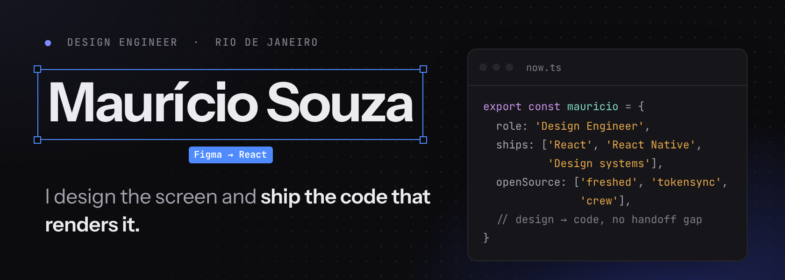
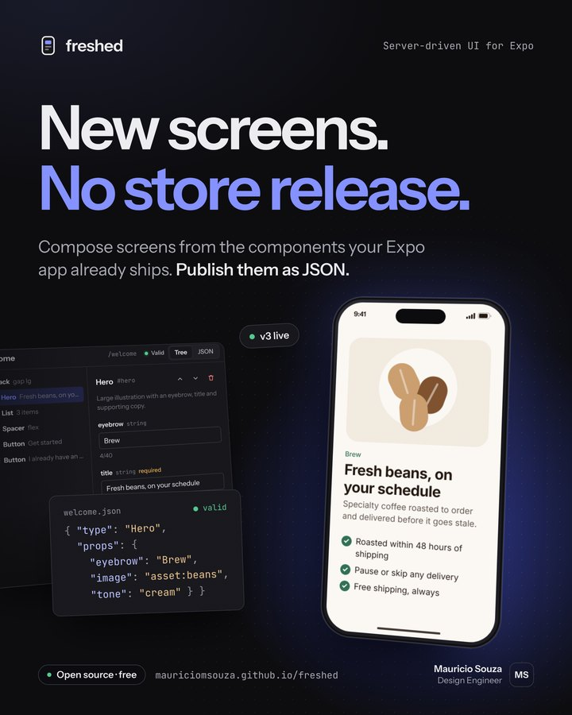
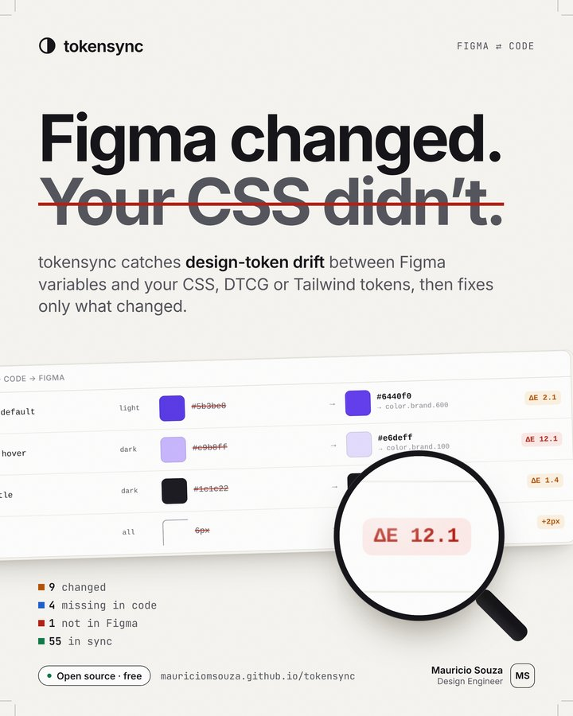
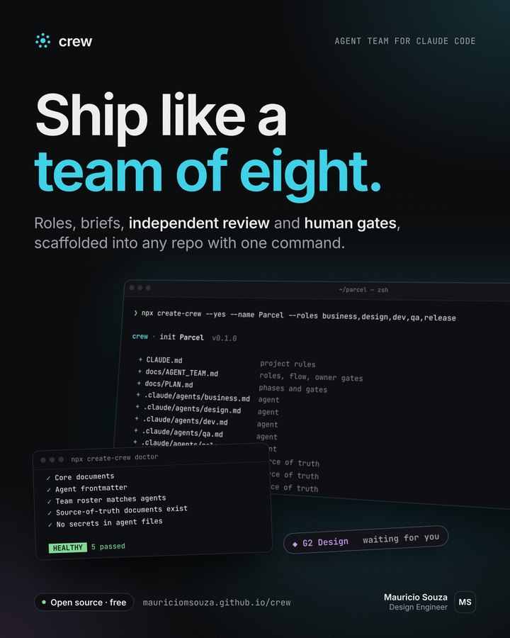

<picture>
  <source media="(prefers-color-scheme: dark)" srcset="assets/banner-dark.png" />
  <source media="(prefers-color-scheme: light)" srcset="assets/banner-light.png" />
  
</picture>

  <a href="https://www.linkedin.com/in/mauricio-soz"><b>LinkedIn</b></a> &nbsp;·&nbsp;
  <a href="mailto:souza.msmauricio@gmail.com"><b>Email</b></a> &nbsp;·&nbsp;
  <a href="#open-source"><b>Open source</b></a> &nbsp;·&nbsp;
  <a href="#experience"><b>Experience</b></a>

I trained as a designer and spent my career on engineering teams. Today I work where the two meet: design systems, product UI in React and React Native, and the tooling that keeps Figma and code telling the same story.

## Open source

Three projects, each with a live demo that runs in the browser. No signup.

<table>
  <tr>
    <td width="33%" valign="top">
      
      <h3><a href="https://github.com/mauriciomsouza/freshed">freshed</a></h3>
      
Self-hosted server-driven UI CMS for Expo and React Native. Compose screens from the components your app already ships and publish them as versioned JSON. An AI connector turns one prompt into draft screens.

      
<a href="https://mauriciomsouza.github.io/freshed/"><b>Live demo →</b></a> React Native · Postgres · TypeScript · <code>@freshed-cms/*</code>

    </td>
    <td width="33%" valign="top">
      
      <h3><a href="https://github.com/mauriciomsouza/tokensync">tokensync</a></h3>
      
Catches design-token drift between Figma variables and code (CSS, DTCG, Tailwind) with perceptual color diffs, PR comments and minimal, format-preserving fixes.

      
<a href="https://mauriciomsouza.github.io/tokensync/"><b>Live demo →</b></a> CLI · GitHub Action · TypeScript · <code>tokensync-cli</code>

    </td>
    <td width="33%" valign="top">
      
      <h3><a href="https://github.com/mauriciomsouza/crew">crew</a></h3>
      
An agent team for Claude Code: roles, briefs, source-of-truth docs, independent review and human approval gates, scaffolded into any repo with one command.

      
<a href="https://mauriciomsouza.github.io/crew/"><b>Live demo →</b></a> Node CLI · AI agents · <code>npx create-crew</code>

    </td>
  </tr>
</table>

## What I bring

- **Design systems end to end.** Tokens, components and documentation that designers and engineers both trust, and checks that keep them in sync.
- **Product UI that ships.** From the first Figma frame to accessible, tested React and React Native in production.
- **AI in the workflow, with humans at the gates.** Agents that draft and review, with people approving what ships.

## Experience

| Role | Company | Focus |
| --- | --- | --- |
| Design Specialist | meutudo | Fintech, Brazil |
| Senior Product Engineer | Casa Amora | Brazil |
| Frontend Tech Lead | Venturus | Mission-critical software for high-volume electronics manufacturing |
| Azure Support Engineer | Microsoft | Lisbon, Portugal |
| Cloud & Software Engineer | Claranet | Lisbon, Portugal |

**Patent:** a Figma extension that reads designs and generates structured user stories for design, engineering and QA. &nbsp;**Education:** Design, PUC-Rio.

## Toolbox

`React` `TypeScript` `React Native` `Expo` `Node.js` `Postgres` `Figma` `Design tokens` `Accessibility (WCAG)` `Vitest` `Playwright` `Azure` `Claude Code`

---

Banner and posters are designed in HTML/CSS and rendered with Playwright. Source in <a href="design/">design/</a>.
